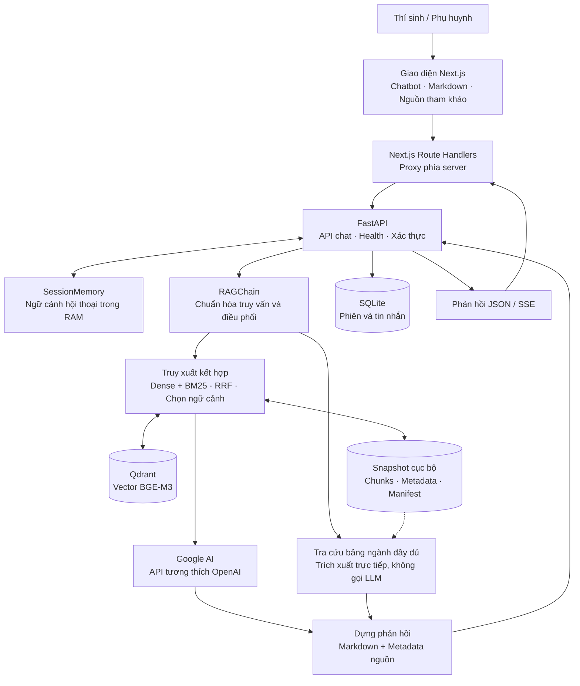
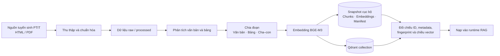

# AdmitAI

**Trợ lý tư vấn tuyển sinh PTIT với kiến trúc RAG.**

AdmitAI kết hợp tìm kiếm ngữ nghĩa, tìm kiếm từ khóa và mô hình ngôn ngữ để trả lời câu hỏi tuyển sinh bằng tiếng Việt. Hệ thống sử dụng kiến trúc RAG (*Retrieval-Augmented Generation*): tìm nội dung liên quan trong kho tri thức trước khi tạo câu trả lời và cung cấp nguồn tham khảo.

Giao diện được xây dựng bằng Next.js; backend FastAPI điều phối truy xuất, sinh câu trả lời và lưu hội thoại. Cấu hình phát triển hiện tại sử dụng Google AI, BGE-M3, Qdrant và BM25.

## Mục lục

- [Chức năng chính](#chức-năng-chính)
- [Kiến trúc hệ thống](#kiến-trúc-hệ-thống)
- [Công nghệ sử dụng](#công-nghệ-sử-dụng)
- [Cấu trúc thư mục](#cấu-trúc-thư-mục)
- [Cài đặt và chạy cục bộ](#cài-đặt-và-chạy-cục-bộ)
- [Cấu hình](#cấu-hình)
- [API và luồng phản hồi](#api-và-luồng-phản-hồi)
- [Kiểm thử và đánh giá](#kiểm-thử-và-đánh-giá)
- [Vận hành và xử lý sự cố](#vận-hành-và-xử-lý-sự-cố)
- [Phạm vi hiện tại](#phạm-vi-hiện-tại)
- [Tài liệu liên quan](#tài-liệu-liên-quan)

## Chức năng chính

- **Tư vấn bằng tiếng Việt:** trả lời câu hỏi về ngành học, phương thức tuyển sinh, điểm chuẩn, học phí và các thông tin có trong kho dữ liệu.
- **Truy xuất kết hợp:** tìm kiếm ngữ nghĩa bằng BGE-M3/Qdrant và tìm kiếm từ khóa bằng BM25; hợp nhất kết quả bằng RRF (*Reciprocal Rank Fusion*) có trọng số, kết hợp tín hiệu năm, cơ sở và chương trình.
- **Khai thác tài liệu có cấu trúc:** xử lý văn bản, bảng và quan hệ đoạn cha–con; hỗ trợ trích xuất danh sách ngành hoặc thông tin ngành trực tiếp từ các bảng đầy đủ.
- **Nguồn tham khảo:** hiển thị tên tài liệu, liên kết, trang và đoạn trích khi có thông tin nguồn tương ứng.
- **Hội thoại và theo dõi dịch vụ:** cung cấp phản hồi JSON/SSE, ngữ cảnh hội thoại theo phiên, lưu tin nhắn vào SQLite và kiểm tra tình trạng từng thành phần qua API health.

## Kiến trúc hệ thống

### Luồng phục vụ hội thoại



Với câu hỏi thông thường, backend lấy dữ liệu liên quan để dựng ngữ cảnh rồi gọi mô hình ngôn ngữ. BM25 được tạo trong bộ nhớ từ các đoạn của snapshot; Qdrant lưu vector và payload tương ứng. Với một số câu hỏi danh sách ngành hoặc thông tin ngành, hệ thống có thể đọc trực tiếp các bảng nguồn đầy đủ và trả `answer_mode="evidence"`.

JSON và SSE dùng chung kết quả sinh câu trả lời. SSE hiện chuyển kết quả sau khi backend đã nhận và xử lý phản hồi; không truyền trực tiếp từng token của provider ra trình duyệt.

### Luồng chuẩn bị kho tri thức



Ingestion và phục vụ hội thoại là hai bước riêng. Công cụ ingestion ghi vào đích mới, không tự chuyển chỉ mục đang chạy. Quy trình kiểm tra và chuyển đổi được mô tả trong [hướng dẫn quản lý chỉ mục](docs/index-migration-runbook.md).

## Công nghệ sử dụng

| Thành phần | Công nghệ | Vai trò |
| --- | --- | --- |
| Giao diện | Next.js 16, React 19, Tailwind CSS | Trang web và chatbot |
| API | FastAPI, Uvicorn, Pydantic | Điều phối yêu cầu, kiểm tra dữ liệu và health |
| Sinh câu trả lời | Google AI qua SDK tương thích OpenAI | Tạo câu trả lời từ ngữ cảnh truy xuất |
| Embedding | BAAI/BGE-M3, SentenceTransformers | Biểu diễn ngữ nghĩa, vector 1.024 chiều |
| Truy xuất | Qdrant, BM25, RRF có trọng số | Tìm kiếm kết hợp và xếp hạng kết quả |
| Lưu trữ | SQLite, SQLAlchemy bất đồng bộ | Tài khoản, phiên và tin nhắn |
| Xử lý tài liệu | pdfplumber, Camelot, BeautifulSoup, Markdownify | Đọc PDF/HTML và chuẩn hóa nội dung |
| Kiểm thử | pytest, HTTPX, Vitest, Testing Library | Kiểm thử backend, API và giao diện |

## Cấu trúc thư mục

```text
AdmitAI/
├── api/                    # FastAPI: routes, schema, khởi động và health
├── frontend/               # Next.js: giao diện, chatbot và API proxy
├── src/
│   ├── auth/               # JWT và xác thực người dùng
│   ├── database/           # Mô hình dữ liệu và kết nối SQLite
│   ├── ingestion/          # Nạp, phân tích và chia đoạn tài liệu
│   ├── query_transform/    # Chuẩn hóa viết tắt và các công cụ biến đổi truy vấn
│   ├── retrieval/          # Embedding, Qdrant, BM25, fusion và chọn dữ liệu
│   └── generation/         # RAGChain, prompt, LLM client và dựng phản hồi
├── scripts/                # Thu thập dữ liệu, ingestion, đánh giá và launcher
├── tests/                  # Kiểm thử backend và API
├── eval/                   # Bộ câu hỏi và dữ liệu đánh giá
├── docs/                   # Tài liệu thiết kế và vận hành
├── data/                   # Corpus, chỉ mục và SQLite cục bộ, không đưa vào Git
├── models/                 # Cache model cục bộ, không đưa vào Git
├── docker-compose.yml      # Dịch vụ Qdrant và cấu hình container backend
├── requirements.txt        # Phụ thuộc Python
└── .env.example            # Mẫu cấu hình backend
```

## Cài đặt và chạy cục bộ

Hướng dẫn dưới đây dành cho cấu hình phát triển **Windows + PowerShell** đang được hỗ trợ: một API trên cổng `8000`, một worker, không bật Uvicorn reloader.

### 1. Chuẩn bị môi trường

- Python **3.10 trở lên**.
- Node.js **20.9 trở lên** và npm.
- Docker có hỗ trợ Docker Compose để chạy Qdrant.
- API key Google AI hợp lệ.
- Corpus, snapshot chỉ mục, Qdrant collection tương ứng và cache BGE-M3 đã được chuẩn bị cục bộ.

**Bản clone từ GitHub không bao gồm dữ liệu, database, vector hay trọng số model.** Cần cấp hoặc khôi phục các tài nguyên này trước khi chạy backend. Khởi động Qdrant mới chỉ tạo dịch vụ, chưa tạo kho tri thức có dữ liệu.

Từ thư mục gốc dự án:

```powershell
python -m venv .venv
.\.venv\Scripts\Activate.ps1
python -m pip install -r requirements.txt
Copy-Item .env.example .env
```

Điền `LLM_API_KEY` và thay `JWT_SECRET_KEY` bằng giá trị riêng trong `.env`. Các giá trị mẫu chỉ dùng để mô tả cấu hình. Giữ thông tin xác thực trong file môi trường cục bộ, không đưa vào Git.

### 2. Khởi động Qdrant

```powershell
docker compose up -d qdrant
```

Profile hiện tại sử dụng cặp dữ liệu cố định:

| Tài nguyên | Giá trị |
| --- | --- |
| Chỉ mục cục bộ | `data/index/module3-phase-a-20261019-223230` |
| Qdrant collection | `admitai_chunks_phase_a_20261019_223230` |
| Số đoạn tìm kiếm | 3.185 |
| Embedding | BGE-M3, 1.024 chiều |
| Cache model mặc định | `models/huggingface/hub/` |

Giữ chỉ mục và collection đồng bộ về ID, nội dung, metadata và cấu hình embedding. Không rebuild chỉ mục trong quá trình khởi động thông thường; xem [quy trình kiểm tra và migration](docs/index-migration-runbook.md) khi cần chuẩn bị dữ liệu mới.

### 3. Kiểm tra và khởi động backend

Sau khi kiểm tra cấu hình xác thực, chạy:

```powershell
powershell -NoProfile -File scripts/start_local.ps1 -Action Check -SecurityGateConfirmed
```

`Check` kiểm tra chỉ mục, collection, cache model và trạng thái tiến trình; không khởi động hoặc dừng API. Cờ `-SecurityGateConfirmed` lưu xác nhận cục bộ rằng cấu hình xác thực đã được kiểm tra, không lưu giá trị khóa.

Khi kết quả kiểm tra đạt yêu cầu:

```powershell
powershell -NoProfile -File scripts/start_local.ps1 -Action Start
```

Launcher kiểm tra các điều kiện khởi động và chỉ quản lý tiến trình được xác định thuộc dự án. Nếu khởi động thất bại, launcher báo nguyên nhân và không chuyển sang phiên bản ứng dụng hoặc chỉ mục cũ.

Kiểm tra dịch vụ trong một cửa sổ PowerShell khác:

```powershell
Invoke-RestMethod http://127.0.0.1:8000/api/health
```

Chỉ sử dụng chatbot khi health báo `status="healthy"` và thành phần `rag` sẵn sàng. Swagger UI nằm tại [http://127.0.0.1:8000/docs](http://127.0.0.1:8000/docs).

### 4. Khởi động frontend

Mở terminal mới tại thư mục gốc dự án:

```powershell
Copy-Item frontend/.env.local.example frontend/.env.local
cd frontend
npm ci
npm run dev
```

Truy cập [http://localhost:3000](http://localhost:3000). Biến `BACKEND_URL` được Next.js đọc ở phía server và mặc định trỏ tới `http://127.0.0.1:8000`. Khi frontend chạy trong container, sử dụng hostname của dịch vụ backend thay cho địa chỉ loopback.

### 5. Dừng backend

Chạy từ thư mục gốc dự án:

```powershell
powershell -NoProfile -File scripts/start_local.ps1 -Action Stop
```

Launcher chỉ dừng API đã ghi nhận và xác minh. Dừng frontend bằng `Ctrl+C` trong terminal chạy Next.js.

## Cấu hình

Backend đọc `.env`; frontend đọc `frontend/.env.local`. Tham khảo đầy đủ tại [.env.example](.env.example), [src/config.py](src/config.py) và [mẫu cấu hình frontend](frontend/.env.local.example).

| Biến | Ý nghĩa |
| --- | --- |
| `LLM_API_KEY`, `LLM_BASE_URL`, `LLM_MODEL` | Thông tin kết nối và model sinh câu trả lời |
| `LLM_TIMEOUT_SECONDS`, `LLM_MAX_RETRIES` | Thời gian chờ và số lần thử lại provider |
| `JWT_SECRET_KEY` | Khóa ký token xác thực |
| `DATABASE_URL` | Kết nối database, mặc định SQLite tại `data/admitai.db` |
| `QDRANT_HOST`, `QDRANT_PORT`, `QDRANT_COLLECTION` | Kết nối kho vector |
| `INDEX_DIR` | Đường dẫn snapshot chỉ mục cục bộ |
| `HUGGINGFACE_CACHE_DIR` | Thư mục cache model |
| `LOCAL_DEV_PROFILE` | Bật profile phát triển cố định của dự án |
| `BACKEND_URL` | Địa chỉ backend, chỉ cấu hình phía server Next.js |
| `BACKEND_REQUEST_TIMEOUT_MS` | Thời gian chờ của proxy frontend |

Khi `LOCAL_DEV_PROFILE=true`, cấu hình áp dụng cặp chỉ mục/collection nêu trên, dùng `RERANK_BACKEND=lite`, tắt query rewrite và bật `MODELS_LOCAL_ONLY=true`. Model được nạp từ cache cục bộ; ứng dụng không tự tải model khi khởi động. Profile này yêu cầu BGE-M3 và endpoint Google AI đã cấu hình.

## API và luồng phản hồi

| Endpoint | Chức năng |
| --- | --- |
| `GET /api/health` | Kiểm tra database, chỉ mục, Qdrant, cấu hình LLM và RAG |
| `POST /api/chat` | Gửi câu hỏi, nhận câu trả lời và nguồn tham khảo |
| `POST /api/auth/login` | Đăng nhập và nhận JWT |

Chat mặc định trả SSE; đặt `Accept: application/json` để nhận toàn bộ phản hồi JSON từ backend. Ví dụ chạy trong PowerShell:

```powershell
$chatBody = @{
    message = 'PTIT có những phương thức tuyển sinh nào năm 2026?'
} | ConvertTo-Json

Invoke-RestMethod -Uri http://127.0.0.1:8000/api/chat `
    -Method Post `
    -ContentType 'application/json; charset=utf-8' `
    -Headers @{ Accept = 'application/json' } `
    -Body ([System.Text.Encoding]::UTF8.GetBytes($chatBody))
```

Gửi thêm `session_id` từ phản hồi trước để tiếp tục phiên đang có trong bộ nhớ. Phản hồi gồm `answer`, `citations`, `route_type`, `session_id` và `answer_mode` khi có nhánh phản hồi tương ứng.

Nguồn tham khảo là tùy chọn. Backend ánh xạ ID nguồn hợp lệ sang metadata của tài liệu thực, dựng Markdown và kiểm tra định dạng phản hồi. **Hiện không có lớp grounding tự động kiểm chứng tính đúng của nội dung, số liệu hoặc mức độ nguồn hỗ trợ câu trả lời.** Thiếu citation không làm câu trả lời bị từ chối.

Phản hồi rỗng hoặc JSON nội bộ không thể dựng trả lỗi `INVALID_GENERATION`; lỗi provider và truy xuất có mã riêng. Chi tiết cơ chế tại [sinh câu trả lời và nguồn tham khảo](docs/chat-generation-and-citations.md), schema và mã lỗi tại [đặc tả API](docs/05-api-specification.md).

## Kiểm thử và đánh giá

Chạy kiểm thử backend từ thư mục gốc, trong môi trường Python đã cài phụ thuộc:

```powershell
python -m pytest tests -q
```

Chạy kiểm thử và kiểm tra mã frontend:

```powershell
cd frontend
npm test -- --maxWorkers=1
npm run lint
```

Đánh giá truy xuất từ thư mục gốc, với snapshot đã được chuẩn bị:

```powershell
python scripts/validate_golden_dataset.py
python scripts/evaluate_domain_lite.py --all-cases --runs 1 --output test-results/evaluation-all.json
```

Lệnh đánh giá mặc định chạy với nhánh BM25, không đại diện cho toàn bộ hybrid retrieval. Thêm `--dense-qdrant` để đánh giá cùng nhánh dense thực; khi đó cần Qdrant và cache BGE-M3 sẵn sàng. Test tải model offline cũng cần snapshot model đầy đủ. Kiểm thử với provider thật cần API key và dịch vụ RAG hoạt động.

## Vận hành và xử lý sự cố

Health trả trạng thái riêng cho từng thành phần. `status="degraded"` cho biết dịch vụ chưa sẵn sàng đầy đủ dù tiến trình API vẫn đang chạy. Báo cáo kiểm tra, log và PID của launcher nằm trong `unified-local-results/`; kết quả test cục bộ nằm trong `test-results/`. Các thư mục này được Git bỏ qua.

| Hiện tượng hoặc mã lỗi | Hướng kiểm tra |
| --- | --- |
| `INDEX_MISSING`, `INDEX_FINGERPRINT_MISSING` | Kiểm tra snapshot và manifest; khôi phục dữ liệu phù hợp, không tự tạo fingerprint thay thế |
| `COLLECTION_MISMATCH`, `QDRANT_INDEX_MISMATCH` | Đối chiếu collection với chỉ mục cục bộ về ID, payload và cấu hình vector |
| `MODEL_UNAVAILABLE` | Kiểm tra cache BGE-M3 và các file trong snapshot; bổ sung snapshot đầy đủ trước khi khởi động lại |
| `INSUFFICIENT_MEMORY` | Giải phóng tài nguyên hoặc tăng bộ nhớ khả dụng rồi khởi động lại backend |
| `LLM_AUTHENTICATION_FAILED`, `LLM_RATE_LIMITED`, `LLM_TIMEOUT` | Kiểm tra API key, quota, kết nối và timeout của provider |
| Frontend không kết nối được backend | Kiểm tra health trực tiếp trên cổng `8000`, sau đó kiểm tra `BACKEND_URL` và log proxy |
| Lỗi socket hoặc named pipe trên Windows | Dùng launcher một worker; tránh chạy thêm Uvicorn reloader song song |

RAM và bộ nhớ cam kết (commit) được ghi nhận để chẩn đoán, không tạo ngưỡng chặn khởi động cố định. Sau lỗi cấp phát bộ nhớ hoặc thiếu model, health không tự nạp lại model liên tục; cần xử lý nguyên nhân rồi khởi động lại. Lỗi phụ thuộc tạm thời được thử lại theo thời gian chờ cấu hình.

## Phạm vi hiện tại

- Chất lượng câu trả lời phụ thuộc độ phủ, độ mới của tài liệu, kết quả truy xuất và provider. Citation cung cấp khả năng tra cứu nguồn, không phải chứng nhận câu trả lời đúng.
- Kho dữ liệu tĩnh không xác nhận tình trạng còn chỗ, số phòng hoặc thông tin tồn theo thời gian thực.
- Ngữ cảnh hội thoại nằm trong `SessionMemory` của tiến trình. Tin nhắn được lưu vào SQLite, nhưng phiên trong RAM hiện không được tự khôi phục từ database sau khi backend khởi động lại.
- Các endpoint quản trị tài liệu, lịch sử, chuyển tiếp hỗ trợ và nhận feedback còn có phần trả dữ liệu mẫu hoặc phản hồi khung (*stub*); chưa tạo thành quy trình quản trị hoàn chỉnh.
- Các tài liệu thiết kế trong `docs/` có thể bao gồm lộ trình phát triển. Phạm vi mô tả ở README này và mã triển khai hiện tại là căn cứ cho việc chạy cục bộ.

## Tài liệu liên quan

| Tài liệu | Nội dung |
| --- | --- |
| [Tổng quan dự án](docs/00-project-overview.md) | Mục tiêu, đối tượng sử dụng và định hướng |
| [Thiết kế kiến trúc](docs/02-system-architecture.md) | Thiết kế hệ thống và các thành phần |
| [Dữ liệu và database](docs/04-data-and-database.md) | Cấu trúc dữ liệu và mô hình lưu trữ |
| [Đặc tả API](docs/05-api-specification.md) | Endpoint, schema và quy ước phản hồi |
| [Pipeline RAG](docs/06-ai-rag-pipeline.md) | Thiết kế xử lý tài liệu và truy xuất |
| [Sinh câu trả lời và nguồn tham khảo](docs/chat-generation-and-citations.md) | Cơ chế phản hồi hiện tại sau khi gỡ grounding |
| [Quản lý và migration chỉ mục](docs/index-migration-runbook.md) | Kiểm tra tính toàn vẹn và chuẩn bị chỉ mục mới |
| [Kiểm thử và đánh giá](docs/10-testing-evaluation.md) | Chiến lược kiểm thử và đo chất lượng |
